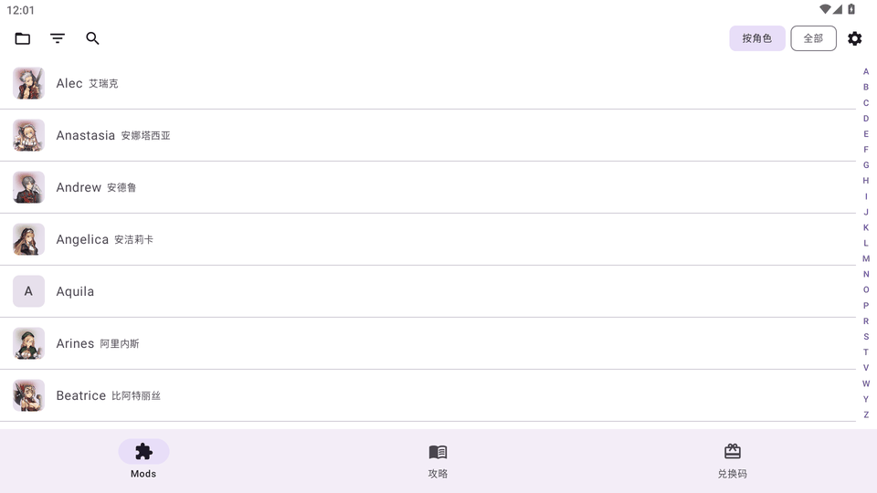

[](https://github.com/Haru762/BD2ToolsBox/releases/latest)
[](./LICENSE)
[-3DDC84)](https://github.com/Haru762/BD2ToolsBox/releases)

[简体中文](./README.md) | [English](./README.en.md)

# BD2 ToolsBox

**在手机上直接管理、预览和装入《棕色尘埃 2》（Brown Dust 2）的 Mod，无需电脑。**

---

## 界面预览

| 功能浏览与操作演示 | 主题配色与明暗模式 |
| :---: | :---: |
|  |  |

---

## 核心功能

*   **全程手机操作**：解包、贴图转换（支持 ASTC 编码与自动图集合并）、重打包全部在安卓设备上本地完成。
*   **按角色与皮肤浏览**：自动扫描多个 Mod 文件夹（支持文件夹与任意层级 `.zip`），按角色分组展示立绘头像、快速字母索引与搜索筛选。
*   **批量转换与后台保活**：一次勾选多个不同分组的 Mod 并行转换；转换、装入、建立文件索引、批量预解包均由前台服务保活，切后台或息屏不中断。
*   **Shizuku 一键装入与安全恢复**：
    *   转换完成后通过 Shizuku 自动移入游戏目录（同目录暂存 + 哈希校验 + 原子替换，绝不留下半截损坏的 `__data`）；
    *   装入前自动备份可信原版资源，卸载时免流量秒还原；
    *   若装入中途被系统强杀，重启后自动检测并支持「**核对并修复记录**」，无需重复转换安装；
    *   自动在 Mod 目录建立 `.nomedia`，防止大量 Mod 贴图污染手机相册。
*   **Spine 动画与静态贴图预览**：点按预览即可直接播放 Mod 的 Spine 骨骼动画（支持浅色/深色背景跟随）；支持「**批量预解包**」，预解包后预览秒开；纯立绘类 Mod 支持静态贴图查看。
*   **GameKee 攻略板块**：直连 GameKee 棕尘 2 分区——分类树、全文搜索、v2/v3 阵容模拟器组件应用内还原、评论区与表情包渲染，正文自动缓存支持离线阅读，并随应用明暗主题自适应。
*   **多账号兑换码一键兑换**：同步最新可用兑换码，支持保存多个游戏昵称一键批量兑换；自动跳过已兑换/已过期码，按账号明细展示兑换结果，奖励直发游戏内邮箱。
*   **个性化外观**：支持浅色 / 深色 / 跟随系统三种模式、7 套主题配色预设、Android 12+ Material You 动态取色，以及可调节遮罩强度的自定义背景壁纸。
*   **内置实用工具**：独立游戏 Bundle 解包器（导出至 `Download/outputs/`）、一键导出本机诊断日志。

---

## 快速上手

### 环境要求

*   **Android 10（API 29）及以上**。
*   已安装官方最新版《棕色尘埃 2》（Brown Dust 2）。
*   [Shizuku](https://shizuku.rikka.app/) —— 用于建立游戏文件索引与一键移入游戏目录（未启动 Shizuku 时仍可转换和预览 Mod，但无法直接写入游戏目录）。

### 安装与配置

1.  从 [Releases](https://github.com/Haru762/BD2ToolsBox/releases) 下载对应架构的 APK 安装（**单架构精简包，体积仅约 21.7 MB**）：
    *   **手机 / 平板真机**：下载 `arm64-v8a` 版本；
    *   **电脑安卓模拟器（MuMu / 雷电等）**：下载 `x86_64` 版本。
2.  启动 Shizuku 并完成对 BD2 ToolsBox 的授权。
3.  打开应用，点击左上角文件夹图标「**打开 / 添加 mod 文件夹**」，选择存放 Mod 的目录（支持同时添加和管理多个目录）。
4.  首次使用或游戏大版本更新后，可在左上角菜单点击「**建立文件索引**」（支持断点续扫），完成后即可识别全部立绘、剧情、约会与好感度类 Mod。

> 💡 **建议**：在手机存储中新建一个专用目录（例如 `BD2_Mods`），将所有 Mod 集中放在该目录下；应用会自动写入 `.nomedia` 避免相册混入贴图。

---

## Mod 目录结构说明（重要）

每个 Mod 放在单独的文件夹或 `.zip` 压缩包内，内部文件名必须与游戏原始资源名**一致**。支持多层子目录自动递归扫描，直接选择合集总目录即可。

> **⚠️ 注意：所有文件名必须全小写**（例如 `char000104.png` 而非 `Char000104.png`），且 `.atlas` 文件内引用的贴图文件名也必须为小写，否则可能导致游戏闪退。

**目录结构示例：**
```text
BD2_Mods/
├── Lathel_DarkKnight_IDLE/
│   ├── char000104.skel      （骨骼文件，或 .json）
│   ├── char000104.atlas     （图集映射）
│   └── char000104.png       （贴图文件）
└── Another_Mod.zip          （支持直接读取 .zip 压缩包）
```

---

## 装入与卸载流程

1.  **选择 Mod**：
    *   在「**按角色**」视图下点击角色头像，在弹出的皮肤卡片中可直接点「**装入**」或勾选多套皮肤批量装入；
    *   在「**全部**」视图下可跨角色勾选多个 Mod 批量处理。
2.  **转换与自动装入**：点击开始后，应用会自动复用本地干净原版（或从官方 CDN 下载原版基底）、自动合并超出的贴图页并重打包；若 Shizuku 正在运行，转换完成后将**自动装入游戏目录**，**重启游戏即可生效**。
3.  **卸载还原**：可在角色卡片或列表中单独卸载某个 Mod，也可在「**设置 → 一键卸载全部 mod**」中将所有修改过的资源还原为官方原版。

手动搬运时的目标路径：`/Android/data/com.neowizgames.game.browndust2/files/UnityCache/`

---

## 常见问题

**Q：列表里看不到我的 Mod 或显示“未识别”？**
1. 检查「添加 mod 文件夹」所选目录是否正确，Mod 是否包含完整的 `.skel`/`.json` + `.atlas` + `.png`（或已转换的 `__data`）；
2. 若是剧情、约会或新角色皮肤，请先在左上角菜单执行一次「**建立文件索引**」，完成后点击「**重新扫描**」。

**Q：装完 Mod 游戏闪退或贴图错乱？**
*   转换器已内置自动图集合并（当 Mod 贴图数多于原版时自动合并）；
*   请重点检查 Mod 内文件名以及 `.atlas` 中引用的 `.png` 名称是否**全部为小写**；
*   确认为完整兼容 Android 端的 Mod（需同时具备 `.png`、`.atlas` 和 `.skel`/`.json`）。

**Q：提示“上次装入可能没有完整收尾”怎么办？**
当装入过程中应用被系统强行终止时，启动后会显示恢复横幅与提示。请直接点击「**核对并修复记录**」，应用会只读比对游戏目录文件哈希并自动补齐安装记录，无需重新转换安装。

---

## 开发与验证

### 一条命令跑完本地验证（不需要设备）

```powershell
& (Join-Path $Root 'tools/verification.ps1') -ProjectRoot $Root -Mode LocalAll
```

依次跑：依赖解析 → 全部 JVM 单测 → 全部 Python 测试 → 两个 ABI 的 release 构建 →
静态审计（分层架构、APK 组成/ABI/native/资源/DEX 键名、native ABI）。
**任一步失败即非零退出；skip 不算通过。** 设备测试**不**包含在内，必须显式调用
`Test-Bd2Device` / `Test-Bd2ReleaseSmoke`，不会默认往已连接设备上装东西。

完整清单、干净构建与可复现性边界见 [`docs/refactor/build-and-verify.md`](docs/refactor/build-and-verify.md)。

### 工具链与版本

| 项 | 值 | 位置 |
|---|---|---|
| Kotlin / AGP / Gradle | 2.2.20 / 8.11.1 / 8.13 | `gradle/libs.versions.toml` |
| Chaquopy（Python 运行时） | 16.1.0，目标解释器 **3.8** | `app/build.gradle.kts` |
| compileSdk / minSdk / targetSdk | 36 / **29** / 34 | `gradle/libs.versions.toml` |
| NDK（native 剥离） | 26.3.11579264 | `gradle/libs.versions.toml` |
| App 发布版本 | `versionName` / `versionCode` | **`gradle/version.properties`**（可用 `APP_VERSION_NAME` 覆盖） |
| Python 依赖锁定 | 9 个直接依赖 `==` 锁定 | `app/requirements-android.txt`（解析结果见 `docs/refactor/python-dependencies.md`） |

构建机 Python 按 `local.properties` 的 `chaquopy.python` → `CHAQUOPY_PYTHON` → `PATH`
依次查找；Android SDK 读 `local.properties` 的 `sdk.dir`。**不写死绝对路径。**

### 两个 ABI 分开分发

| ABI | flavor | 产物 |
|---|---|---|
| arm64-v8a（手机） | `arm64` | `app/build/outputs/apk/arm64/release/app-arm64-release.apk` |
| x86_64（模拟器） | `x64` | `app/build/outputs/apk/x64/release/app-x64-release.apk` |

不再产出 universal 包：单 ABI flavor 让 `lib/` 与 Chaquopy 的 `assets/IMY` **都只含当前架构**。

### 主题与壁纸

浅色 / 深色 / 跟随系统三选一，另有七套配色预设与「跟随壁纸取色」（Android 12+）。
自定义壁纸只存 SAF URI（不拷图进应用目录），并可在设置里调遮罩强度。
**壁纸只在背景层可见；列表、工具栏、弹窗等文字密集区一律用不透明底色**，
不让图片穿过文字。

### 后台限制与数据恢复

*   转换 / 装入 / 扫描 / 预解包都挂在**前台服务**上（通知栏可见进度）。
  系统拒绝启动前台服务时**明确失败并提示**，不会照常开跑。
*   进程被杀后重启：只读操作日志做**分类**（中断 / 待核对 / 结果未知 / 已提交），
  在界面上说清下一步，**不自动重放**安装步骤、不改账本、不碰游戏文件。
  已提交的事实不会被覆盖。
*   游戏文件的提交是**同目录暂存 + 校验 + 原子替换**，不是事务：目录树拷贝时
  每个文件各自独立提交，失败会按目标分别上报。

磁盘格式与迁移规则见 [`docs/refactor/data-contracts.md`](docs/refactor/data-contracts.md)。

### 许可证

应用内「设置 → 开源许可」由 AboutLibraries 生成，数据来自构建期产出的
`res/raw/aboutlibraries.json`（含 SPDX 全文，**离线可读**）。
组件来源与义务见 [`THIRD-PARTY-NOTICES.md`](THIRD-PARTY-NOTICES.md)，
清单与全文位置见 [`docs/refactor/license-inventory.md`](docs/refactor/license-inventory.md)。

---

## 致谢

本项目站在这些项目之上：

*   [browndust2-repacker-android](https://codeberg.org/kxdekxde/browndust2-repacker-android)（GPL-3.0）——重打包与纹理压缩核心。
*   [ReDustX](https://github.com/Jelosus2/ReDustX)（MIT）——json 转 skel 逻辑与 CDN 下载方法。
*   [UnityPy](https://github.com/K0lb3/UnityPy)（MIT）——Unity 资源读写。
*   [astc-encoder](https://github.com/ARM-software/astc-encoder)（Apache-2.0）——官方 ASTC 纹理编码器。
*   [BD2ModManager](https://github.com/bruhnn/BD2ModManager)（GPL-3.0）——角色元数据（中文名 / 性别 / 头像）来源。
*   数据来源：[browndust2modding.pages.dev](https://browndust2modding.pages.dev/characters)（角色表）、[Brown-Dust-2-Asset](https://github.com/myssal/Brown-Dust-2-Asset)（头像与立绘）。

各组件在代码里的位置与完整清单见 [THIRD-PARTY-NOTICES.md](THIRD-PARTY-NOTICES.md)。

---

## 许可

本项目按 **GNU General Public License v3** 分发，全文见 [`LICENSE`](LICENSE)。

选择 GPLv3 是有意为之：角色元数据提取自 GPL-3.0 项目（见致谢），也想与社区工具生态保持同样的开放义务。有一点需要注意（详见 [THIRD-PARTY-NOTICES.md](THIRD-PARTY-NOTICES.md)）：

-   `pixi-spine` 使用与 GPL 不兼容的 SPINE-LICENSE，**不随 APK 分发**——首次使用动画预览时由 app 从 npm CDN 自行下载。

*Brown Dust 2* 及其全部游戏素材版权归 Neowiz / Round8 Studio 所有。本工具只修改本地游戏缓存，不分发任何游戏素材。
